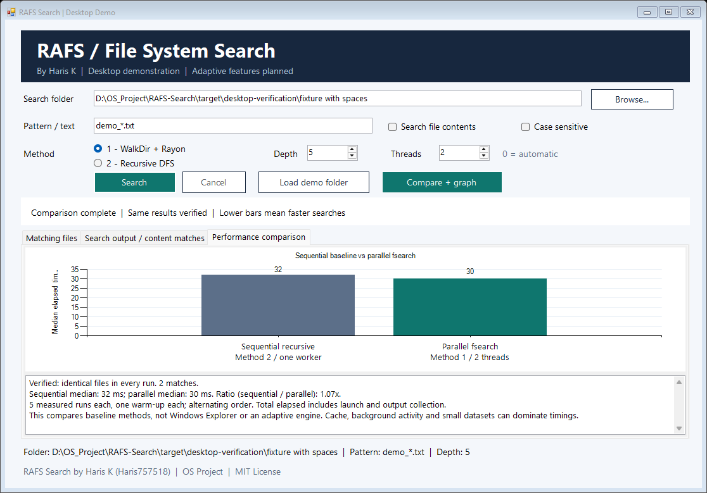

# RAFS Search

**Runtime-Adaptive File System Search Using Workload-Aware Traversal and Concurrency Selection**

OS project by **Haris K ([Haris757518](https://github.com/Haris757518))**.

The project extends Hadi Cahyadi's Rust fsearch engines with bounded hybrid selection between sequential DFS, WalkDir + Rayon and dynamic DFS/BFS, concurrency feedback, live telemetry and correctness-checked comparisons. See the [hybrid research report](research/REPORT.md) for 923 experimental invocations, fastest-fixed comparisons, graphs and measured limitations, and [PROJECT_STATUS.md](PROJECT_STATUS.md) for current behavior.

For the Windows 1.1 installer/portable package, see [PRODUCTION_GUIDE.md](PRODUCTION_GUIDE.md) and the [23 October validation](RELEASE_VALIDATION_2026-10-23.md). Build the ZIP with `desktop-app\package.ps1`, then Setup with `desktop-app\build-installer.ps1`. Adaptive is not guaranteed to win every query: the report records retained deep/wide/mixed gains and remaining flat/tiny-folder overhead.

## Run the desktop app

Build once on Windows, then double-click `RAFS-Search.exe` in the project root:

```powershell
cargo build --release
.\desktop-app\build.ps1
```

The interface supports folder browsing, filename/text-content search, depth settings, five search strategies, cancellation, CSV export, live monitoring, benchmark generators, duplicate discovery, and a saved light/dark theme.

## Demonstrate the comparison graph

1. Choose an existing folder with enough files to produce meaningful timings.
2. Enter a filename pattern, for example `*.txt`, and choose depth and method-1 thread count.
3. Open **Compare**, choose configurations A/B, warm-ups and measured runs, then click **Run Comparison**.

The chart supports original methods 1/2, RAFS Adaptive, live PowerShell traversal and the Windows Search index. Each configuration receives the selected warm-ups and measured runs, with rotating order. Every run must return the same normalized file paths before a chart is shown. Graph values are median total elapsed milliseconds including process launch, output collection and adaptive instrumentation overhead. Either method may win.



The screenshot shows a real small-fixture test; your results will depend on the folder and workload you choose.

The index baseline queries the Windows Search database through a PowerShell host; it does not time the Explorer window. Unindexed/stale files cause a reported mismatch, and indexing settings are never changed automatically. Cache state, background activity and process overhead influence results. PowerShell/index baselines support filenames only. Content-result path sets are compared; matching line text is not compared by the benchmark. Adaptive policy decisions do not guarantee a speedup.

## Project ownership and upstream attribution

- RAFS desktop interface, comparison demonstration, and project documentation: **Haris K / Haris757518**.
- Reused-engine provenance and original author credit: see [AUTHORS.md](AUTHORS.md) and [LICENSE](LICENSE).
- Original baseline commit: `e74d9d5b72662a23f7ae8a0dde527be3d2517365`.
- Original MIT copyright and author credits have been restored after an earlier attribution edit; full Git history is retained.
- `master` preserves the original baseline; `rafs-development` contains the RAFS additions.

The original documentation is retained in [UPSTREAM_README.md](UPSTREAM_README.md). See [BASELINE_NOTES.md](BASELINE_NOTES.md) for baseline inspection and [desktop-app/README.md](desktop-app/README.md) for app instructions.
