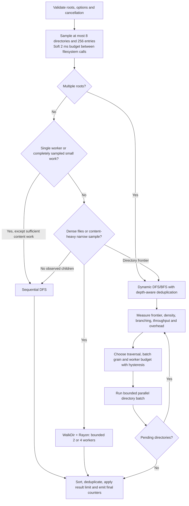

# Hybrid scheduler design

RAFS extends Hadi Cahyadi's MIT-licensed fsearch engines. Its research contribution is the combination of bounded workload observation, selection among existing engines, bounded concurrency feedback and an auditable event stream. DFS, BFS, Rayon, and work stealing are existing techniques; RAFS does not claim to invent them or guarantee the fastest time on every filesystem.

## Selection and execution



Sampling observes metadata and never contributes partial results. The chosen engine traverses the requested search normally, including sampled entries. The selector commits to one engine per invocation; switching engines would require a more complex persistent cursor and is outside this implementation. Within the dynamic engine, traversal and worker budgets can change between batches.

```text
profile = bounded_sample(roots, max_dirs=8, max_entries=256, soft_ms=2)
if multiple_roots: strategy = dynamic
else if one_worker or complete_small_sample_without_substantial_content_work:
    strategy = sequential_DFS
else if dense_file_sample or narrow_content_heavy_sample:
    strategy = fixed_WalkDir_Rayon(2 or 4, capped by worker limit)
else if no_observed_children: strategy = sequential_DFS
else: strategy = dynamic
emit(strategy, sampled characteristics, reason, workers, elapsed time)
execute_selected_strategy_once()

dynamic_batch:
    grain = 16 if density < 8 and scheduling_fraction > 0.10 else 4
    available = min(worker_limit, ceil(pending_directories / grain))
    requested_workers = min(available, retained_phase_ceiling)
    compare throughput only when file density is within a factor of two
    after three comparable batches below 85% of pre-increase throughput:
        halve worker ceiling, subject to a three-epoch dwell
    retain ceiling until workload density changes by more than a factor of two
    reduce immediately if frontier cannot fill current budget
    allow initial frontier expansion promptly
    prefer DFS for queue pressure or branching < 1.5
    prefer BFS for branching > 3; otherwise retain traversal
    apply three-epoch dwell except urgent queue pressure
    process bounded batch; collect real files/directories/active task counts
```

Exact thresholds and ordering are in [adaptive.rs](../src/adaptive.rs). They are engineering heuristics, frozen before the reported full experiment, rather than a learned optimal policy. Density is files per processed directory; branching is discovered children per directory. Controller throughput is recently processed files plus directories per execution millisecond; Live Monitor throughput is cumulative files per second. Scheduling time includes preparing and merging batches, with decision time removed to avoid double counting. Pool startup and profiling are separate timers. Their costs remain in elapsed measurements.

## Audit and reliability

The existing Live Monitor receives selected strategy, reasons, traversal/worker policy changes, elapsed decision times and measured overhead. Active-worker events represent observed executing tasks; a worker budget is not proof every worker was busy continuously. OS values are cached for at most 100 ms between samples and carry an OS-sample timestamp in exported research telemetry. Independent per-process research polling uses the same 10 ms interval for all strategies.

Sequential/fixed engines do not expose a directory frontier. Their queue/branching fields are unavailable rather than invented. Initial sampling can encounter a slow filesystem call and exceed two milliseconds; the budget is cooperative, not a hard deadline. Search cancellation, depth constraints, result limits, content context, exclusions and no-follow symlink behavior are tested. Multiple roots use dynamic depth-aware deduplication so encountering a directory through a deeper root does not suppress a later shallower traversal.

The October 22 dynamic search body is preserved in [adaptive_legacy.rs](../src/adaptive_legacy.rs) as CLI method 4 for research. CLI method 3 and the existing desktop RAFS Adaptive choice use the hybrid. CLI method numbers differ from desktop choices: desktop method 3 is PowerShell and method 4 is Windows Search Index. No additional GUI selector is introduced.

## Related work

- [Kalibera and Jones, *Rigorous Benchmarking in Reasonable Time*, ISMM 2013](https://kar.kent.ac.uk/33611/): repetition and uncertainty motivate recording every invocation and reporting dispersion. Our single-machine, warm-cache bootstrap is a limited experimental design, not the paper's full hierarchical analysis.
- [Agrawal, He and Leiserson, *Adaptive Work-Stealing With Parallelism Feedback*, PPoPP 2007](https://www.microsoft.com/en-us/research/publication/adaptive-work-stealing-with-parallelism-feedback-2/): feedback-directed allocation motivates controlling concurrency according to observed work. RAFS does not implement A-STEAL or inherit its theoretical guarantees.
- [*Configurable Strategies for Work-stealing*, 2013](https://arxiv.org/abs/1305.6474): workload-informed scheduling policies provide context for choosing traversal order and scheduling granularity. RAFS combines existing mechanisms for filesystem traversal rather than proposing a new general work-stealing runtime.
- [Original fsearch by Hadi Cahyadi / cumulus13](https://github.com/cumulus13/fsearch): the reused sequential and parallel search foundation, preserved under its original MIT copyright. RAFS extensions are attributed separately in [AUTHORS.md](../AUTHORS.md).

## Demonstration

1. Algorithm comparison: use the frozen experiment's elapsed-time chart and fastest-fixed comparison. Explain losses as well as wins. Keep PowerShell on a log scale and index coverage outside the live ranking.
2. Runtime adaptation: search a wide/mixed tree in RAFS Adaptive and open the existing Live Monitor. Inspect strategy reasons, traversal/worker events and overhead. Use exported round-1 traces to distinguish budgets from observed active tasks.
3. Resource efficiency: compare process CPU milliseconds, sampled peak working set and completion time on identical datasets. CPU usage percentages are machine-normalized samples; cumulative CPU time is the resource metric used in the report.
