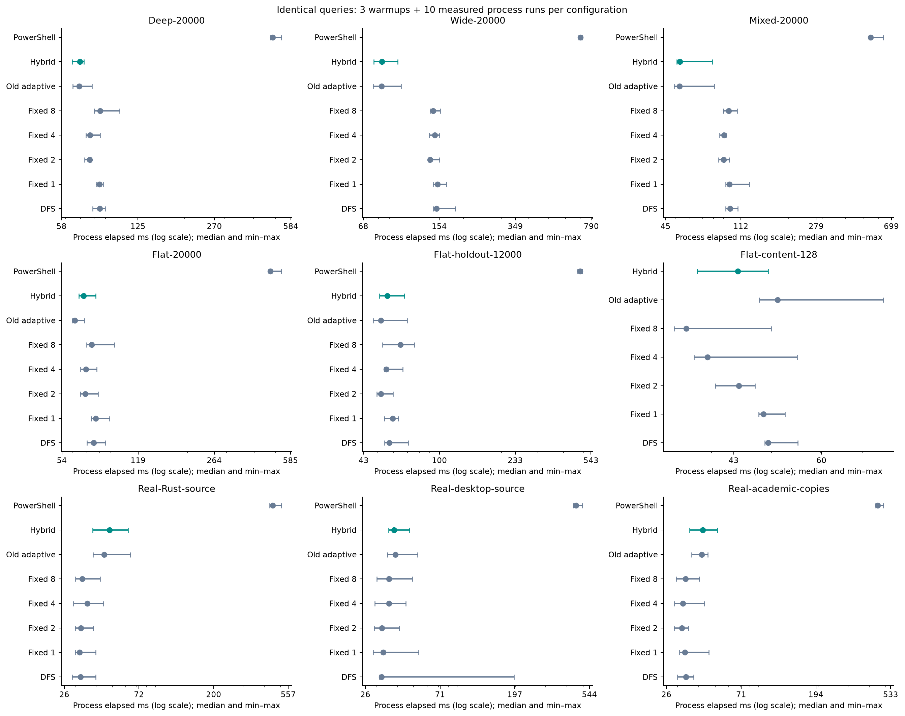
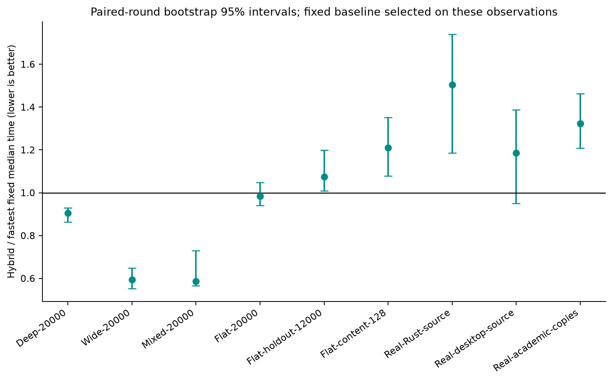
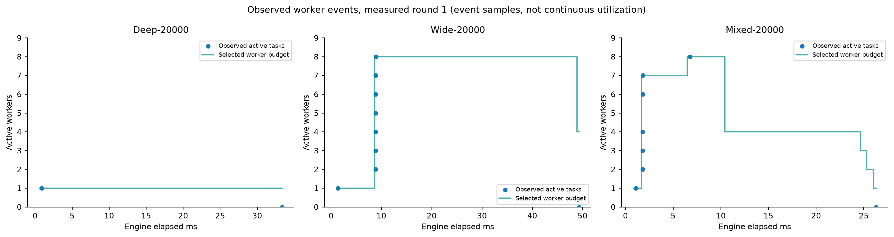
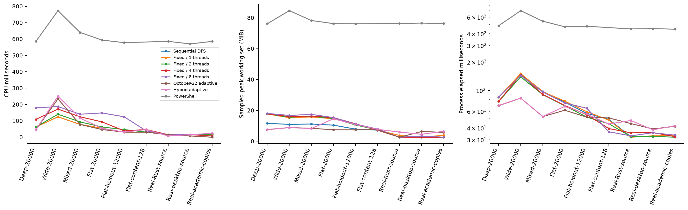
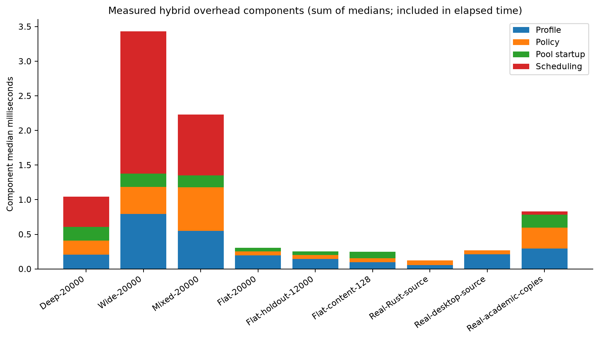

# RAFS hybrid scheduler: implementation and evaluation

**Runtime-Adaptive File System Search Using Workload-Aware Traversal and Concurrency Selection**  
Haris K — 23 October 2026. Original fsearch engines: Hadi Cahyadi / cumulus13, MIT.

## Findings

The hybrid correctly selected among three existing engines, exposed its decisions and overhead, and preserved identical matched paths in all **923 invocations**: 213 warmups and 710 measured runs. Relative to the fastest fixed configuration, its median process time was 9.4% lower on deep, 40.5% lower on wide and 41.4% lower on mixed development workloads. These gains were already largely present in the October 22 dynamic baseline: the new hybrid did not materially improve those three medians over that baseline.

Flat filename performance was close to the fastest fixed method: 1.5% lower on 20,000 files, with an interval crossing parity, and 7.4% higher on the independent 12,000-file fixture. However, the old adaptive baseline was faster than the hybrid on both. Flat text-content search improved 13.8% over old adaptive but remained 21.0% slower than the fastest fixed configuration. Tiny real folders retained an overhead penalty. **The evidence supports a working, explainable hybrid mechanism and retained topology gains; it does not establish that the flat-directory weakness is fully solved or that the hybrid universally improves on the old scheduler.**

## Implementation contribution

RAFS combines bounded workload profiling, selection between sequential DFS/fixed WalkDir+Rayon/dynamic DFS+BFS, bounded concurrency, performance feedback and auditable decisions. It adds mechanisms for three-batch regression confirmation, a retained workload-phase concurrency ceiling and traversal hysteresis. These reduce unnecessary policy reversals without claiming an optimal policy. [DESIGN.md](DESIGN.md) provides pseudocode, a decision flowchart, implementation links and literature positioning.

The original fsearch license and authorship have been restored. The October 22 adaptive search function is retained in `src/adaptive_legacy.rs`; shared event definitions and telemetry handling were extended consistently. Fixed WalkDir now explicitly excludes symlinks/nonregular entries to agree with the application's no-follow policy; a Unix regression checks this. Known synthetic and real experiment inputs contain no such links.

Repetition and uncertainty reporting draw on [Kalibera and Jones, ISMM 2013](https://kar.kent.ac.uk/33611/). Feedback-directed concurrency is motivated by [Agrawal, He and Leiserson, PPoPP 2007](https://www.microsoft.com/en-us/research/publication/adaptive-work-stealing-with-parallelism-feedback-2/), while [Configurable Strategies for Work-stealing](https://arxiv.org/abs/1305.6474) provides context for workload-informed scheduling. RAFS does not implement those systems or claim their theoretical guarantees; its contribution is an evaluated filesystem-specific integration built on [original fsearch](https://github.com/cumulus13/fsearch).

## Protocol and environment

The selector and runnable implementation were frozen at **`f26d83de2a6d85c393a1bd481643dda27e75e513`**, before the full sweep. Engine SHA256: `a47be4010d3d0fe1e1a72f50a38893a18ecc3cde1d59522b834d4ce4367dfb58`. Subsequent changes add documentation and analysis presentation, not engine/harness policy changes. A one-repetition pilot was used to detect controller oscillation and monitoring cost before this freeze; it is not mixed into reported measurements. Thresholds were not retuned after observing this full experiment.

Machine: Intel Core i7-13650HX, 14 physical cores / 20 logical processors, 25,463,480,320 bytes physical memory; Windows 11 Home Single Language build 10.0.26300; .NET Framework 4.8 application (CLR 4.0.30319.42000). All inputs were local on D:. Storage device/cache details were not characterized. No cold-cache claims are made. Builds, local verification and dependency installation completed before the sweep; OS/background activity was not controlled completely.

For every dataset/configuration there were **3 warmups + 10 measured repetitions**, rotating execution order by round. Eight configurations were DFS, fixed parallel 1/2/4/8, old adaptive cap 8, hybrid cap 8 and PowerShell. Content matching excludes PowerShell because this baseline implements filenames only. This gives 71 configuration/dataset cells × 13 invocations = 923. The index was queried once separately.

Ground truth was independent .NET enumeration, plus line-by-line substring matching for generated content. Every invocation had to succeed, report complete scanning and match the expected normalized path set. Counts and SHA256 set hashes are in [datasets.csv](results/datasets.csv); all invocations are in [samples.csv](results/samples.csv). Hashes include normalized absolute paths, so they check equality within this experiment and are not portable content hashes. No academic filenames or document contents are published.

| Dataset | Files scanned in corpus | Directories including root | Maximum directory depth | Expected matched paths |
|---|---:|---:|---:|---:|
| Deep development | 20,000 text + manifest | 25 | 24 | 140 |
| Wide development | 20,000 text + manifest | 2,001 | 1 | 140 |
| Mixed development | 20,000 text + manifest | 651 | 8 | 140 |
| Flat development | 20,000 text + manifest | 1 | 0 | 140 |
| Independent flat holdout | 12,000 | 1 | 0 | 132 |
| Flat content holdout | 128, approximately 61 KiB each | 1 | 0 | 128 |
| Real Rust source | 12 | repository source folder | — | 12 |
| Real desktop source | 55, including non-C# files | repository desktop tree | — | 42 |
| Real academic copies | local PDF corpus | existing local tree | — | 21 |

Filename patterns were `*099*.txt`, `*.rs`, `*.cs` or `*.pdf`; content queried the synthetic `research needle marker`. Academic inputs were copies, not originals. No external dataset download was necessary for this bounded experiment. The real corpora are small and do not establish large real-world performance.

The secondary fixtures are labeled “holdout” in the harness to distinguish them from the four pre-existing development trees. Their generation templates were also exercised during the smoke run, so they are not blinded or wholly unseen validation data. Fresh directories do not make an unchanged template statistically independent of prior inspection. Strong generalization claims would require new independently designed workloads.

Total time covers process launch, output collection, sorting and adaptive instrumentation; engine time is recorded separately. CPU is cumulative child-process CPU milliseconds. Peak working set is observed by identical 10 ms polling for all configurations and may miss brief peaks. Monitoring cost is included and separately recorded. Very short processes and Windows' quantized CPU accounting require caution. Hybrid-only observers and explanatory events are part of the product cost rather than subtracted from its result.

## Experiment 1: algorithm comparison

The graph uses points with min–max whiskers and logarithmic x axes, not bar lengths on a truncated log axis. All configuration medians, population standard deviations, minima/maxima and resource values are in [summary.csv](results/summary.csv).

The fastest fixed baseline is selected per dataset from DFS and fixed 1/2/4/8 using its lowest median. Ratios below 1 favor hybrid. Intervals are percentile bootstrap intervals for ratios of medians, using paired round indices, 10,000 resamples and seed 20261023. Pairing controls round order only, not simultaneous workload conditions. Choosing the fastest baseline from these same data introduces selection bias; ten single-machine repetitions are limited evidence.

| Dataset | Fastest fixed | Fixed median ms | Hybrid ms | Hybrid/fixed, bootstrap 95% | Old adaptive ms |
|---|---|---:|---:|---:|---:|
| Deep 20k | Fixed 2 | 76.633 | 69.411 | 0.906 [0.864, 0.930] | 68.993 |
| Wide 20k | Fixed 2 | 139.518 | 82.974 | 0.595 [0.552, 0.648] | 82.867 |
| Mixed 20k | Fixed 2 | 90.389 | 52.975 | 0.586 [0.566, 0.730] | 52.829 |
| Flat 20k | Fixed 2 | 68.818 | 67.782 | 0.985 [0.940, 1.049] | 61.727 |
| Flat holdout 12k | Fixed 2 | 52.150 | 56.017 | 1.074 [1.008, 1.199] | 52.142 |
| Flat content 128 | Fixed 8 | 36.451 | 44.096 | 1.210 [1.078, 1.352] | 51.126 |
| Real Rust source | Fixed 1 | 31.910 | 47.997 | 1.504 [1.187, 1.740] | 44.567 |
| Real desktop source | DFS | 32.249 | 38.258 | 1.186 [0.949, 1.388] | 39.041 |
| Real academic copies | Fixed 2 | 31.951 | 42.268 | 1.323 [1.209, 1.463] | 41.690 |

Deep/wide/mixed select dynamic mode and retain its advantage over the existing fixed engines. Flat filename mode selects two-worker WalkDir+Rayon: its 20k engine median of 35.813 ms is close to fixed-2's 35.718 ms, but the preserved old scheduler's single-directory execution is faster at 29.604 ms. This is direct evidence that selecting a plausible existing engine is not equivalent to selecting the actual optimum.

The deep tree keeps one executing directory task; its gain cannot be attributed to parallel speedup. Traversal implementation and bookkeeping differ across the engines, and this experiment does not isolate those costs.

Flat content chooses four workers and cuts old adaptive engine time from 18.280 to 7.929 ms. Fixed eight reaches 4.830 ms and lower total time; the conservative worker rule leaves parallelism unused. Small Rust source scans spend well below a millisecond inside the engine (hybrid 0.451 ms versus fixed-1 0.293 ms), while process totals are tens of milliseconds. Instrumentation and process/output handling dominate those end-to-end comparisons. The measurement does not isolate every parent-side overhead component, so a single cause is not asserted.

PowerShell loses these warm-cache process comparisons, with host startup and script traversal included. That fact is useful as a traditional baseline but is not the primary research contribution. The single separate index observation returned **0 indexed PDFs versus 21 live PDFs**. Its coverage is unequal and its time is not ranked; this says nothing about speed on a correctly indexed corpus or the File Explorer window itself.

## Experiment 2: runtime adaptation

All ten measured runs selected dynamic mode on deep/wide/mixed/academic inputs, fixed mode on both flat filename fixtures and content, and sequential DFS on both repository source folders. Reasons, budgets and elapsed policy times are exported in [decisions.csv](results/decisions.csv), with observed task counters in [telemetry.csv](results/telemetry.csv).

Examples from measured round 1:

| Workload | Observed decision sequence |
|---|---|
| Deep | Dynamic selected at 0.225 ms; one worker and DFS retained for narrow frontier. |
| Wide | BFS/one worker initially; at 8.636 ms frontier 2,000 permits eight workers; DFS follows queue pressure; budget falls to four as frontier drains at 48.924 ms. |
| Mixed | One → seven → eight workers as frontier expands; three comparable lower-throughput batches trigger eight → four at 10.414 ms; the phase ceiling prevents immediate re-expansion; frontier draining later reduces four → three → two → one. |

These are actual policy events and sampled active tasks, not proof that each change caused a speedup. Throughput includes processed files plus directories per batch millisecond; comparable density and dwell rules are heuristics. Dynamic mode allocates a pool capped at eight even when fewer tasks are active. Sequential mode avoids pool creation; lower active-worker counts do not mean unused pool threads cease to exist. There is no statistical ablation establishing the separate effect of every new controller rule.

## Experiment 3: resource efficiency and decision overhead

| Dataset | Hybrid CPU ms | Fastest-fixed CPU ms | Hybrid sampled peak MiB | Fixed sampled peak MiB |
|---|---:|---:|---:|---:|
| Deep 20k | 46.875 | 62.500 | 7.62 | 17.75 |
| Wide 20k | 250.000 | 140.625 | 8.86 | 15.58 |
| Mixed 20k | 117.188 | 93.750 | 8.21 | 16.14 |
| Flat 20k | 54.688 | 62.500 | 14.57 | 14.77 |
| Flat holdout 12k | 31.250 | 46.875 | 10.85 | 10.54 |
| Flat content 128 | 46.875 | 39.063 | 7.70 | 7.88 |
| Real Rust | 7.813 | 15.625 | 5.95 | 3.76 |
| Real desktop | 15.625 | 15.625 | 4.51 | 3.34 |
| Real academic | 23.438 | 15.625 | 6.44 | 2.59 |

The wide speed gain costs about 78% more cumulative CPU than its fastest fixed baseline; mixed costs 25% more. Their sampled memory is lower. No claim of universal resource dominance follows. CPU quantization makes tiny-folder ratios particularly weak evidence. The experiment records process memory rather than memory allocated solely by the scheduler and does not measure energy consumption.

Median profiling ranges from 0.056 to 0.792 ms across these datasets; the largest measured-round profile was 0.832 ms. This does not establish a hard maximum. On wide work, median profiling/policy/pool/scheduling components are respectively 0.792/0.392/0.191/2.058 ms. On flat 20k they are 0.196/0.057/0.055/0 ms. Components remain included in elapsed time; they do not exhaust every telemetry or parent-process cost. CPU totals describe the child engine/PowerShell process, not the desktop parent's CPU. The plot adds component medians, which need not equal the median of their per-run sum.

## Reliability and release evidence

Local validation passed 28 Rust unit tests and three documentation tests, formatting and strict Clippy; packaged production, existing feature, layout and soak checks also passed. The one-minute soak completed 1,146 filename/content searches with equal 100-file results, handle counts within the bound (baseline 304, peak 346) and no run-scratch leaks. This is a local repeatability check, not long-term field validation. Linux/macOS/Windows tests and the full 11-job CI workflow passed on the frozen implementation in [CI run 39901578724](https://github.com/Haris757518/RAFS-Search/actions/runs/39901578724).

Release packaging and installer lifecycle checks are documented in [RELEASE_VALIDATION_2026-10-23.md](../RELEASE_VALIDATION_2026-10-23.md). The Windows 1.1.0 build remains unsigned by request. Physical display transitions, screen readers, arbitrary shares, cold caches and multi-machine field testing remain outside completed validation.

## Target assessment and next research work

| Engineering target | Assessment |
|---|---|
| 100% matching result paths | Met for every invocation in this experiment; not a proof for all possible filesystems. |
| Retain deep/wide/mixed gains | Met relative to fastest fixed baselines; effectively parity with the old adaptive medians. |
| Eliminate/substantially reduce flat slowdown | Partly met relative to fixed methods, not demonstrated as an improvement over old adaptive for flat filenames. |
| Stay close to fastest fixed configuration | Met on large filename fixtures; not met on tiny real folders or flat content under the chosen worker rule. |
| Avoid unnecessary workers/overhead | Mechanisms implemented and observable; resource dominance not established. |
| Reliability/no regressions | Existing local checks and cross-platform CI passed; broad field testing remains. |

The next defensible work is an independent ablation of observer/output cost on tiny scans, a file-cost-aware worker rule for flat content, and a single-directory execution path that preserves the old scanner's advantage without abandoning bounded selection. Any new policy should be frozen and evaluated on fresh holdouts, followed by cold-cache and multi-device experiments. Adding methods or dashboards would not resolve the measured limitations.

The supported contribution is a hybrid runtime-adaptive scheduler that integrates workload profiling, traversal selection, concurrency feedback and explainable measurements. Evidence shows retained performance across several structures and useful content parallelism, alongside clear limits in choosing the best engine and amortizing overhead. It does not support an unconditional claim that RAFS Adaptive is always fastest.
